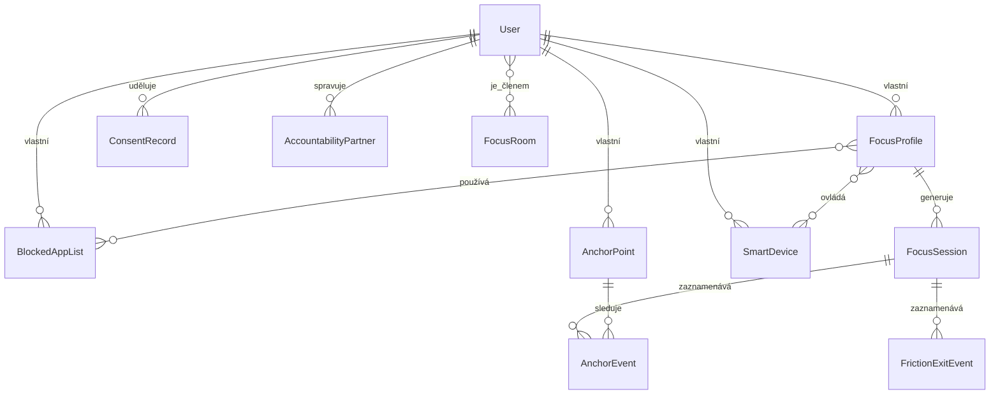

# Datový model — Kotva (draft v0, k odsouhlasení)

> Dle [spec.md § 15](spec.md#15-co-od-tebe-očekávám-jako-výstup): datový model je první krok a
> musí být odsouhlasen před další prací. Toto je návrh v0 — očekávám zpětnou vazbu než se pustíme
> do Sprintu 0 v [roadmap.md](roadmap.md).

## Přehled entit

### User
Účet uživatele.

| Pole | Typ | Poznámka |
|---|---|---|
| id | string | Firebase Auth UID |
| email | string | |
| displayName | string | |
| createdAt | timestamp | |
| subscriptionTier | enum(free, premium) | viz [spec.md § 12](spec.md#12-monetizace) |

### FocusProfile
Uživatelem definovaný "profil" fokus session (1 uživatel : N profilů).

| Pole | Typ | Poznámka |
|---|---|---|
| id | string | |
| userId | string → User | |
| name | string | |
| durationMinutes | int | 15–180 |
| goalText | string | volný text |
| strictnessLevel | enum(mild, medium, strict) | |
| blockedListIds | string[] → BlockedAppList | M:N |
| smartDeviceIds | string[] → SmartDevice | M:N |

### BlockedAppList
Pojmenovaný seznam appek/webů (např. "Sociální sítě"). M:N s FocusProfile — jeden seznam lze
přiřadit více profilům.

| Pole | Typ | Poznámka |
|---|---|---|
| id | string | |
| userId | string → User | |
| name | string | |
| platformIdentifiers | object | `{android: [balíčky], ios: [bundle/token]}` — iOS reprezentuje appky přes `FamilyActivitySelection` tokeny, ne bundle ID (viz [architecture.md](architecture.md)) |

### FocusSession
Jeden proběhlý/probíhající blok (1 profil : N sessions).

| Pole | Typ | Poznámka |
|---|---|---|
| id | string | |
| userId | string → User | |
| focusProfileId | string → FocusProfile | |
| startedAt | timestamp | |
| endedAt | timestamp \| null | |
| plannedDurationMinutes | int | snapshot z profilu v době startu |
| actualDurationMinutes | int \| null | |
| status | enum(active, completed, interrupted) | |
| streakSnapshot | int | hodnota streaku po této session |

### AnchorPoint
NFC tag nebo BLE maják přiřazený uživatelem (1 uživatel : N kotev).

| Pole | Typ | Poznámka |
|---|---|---|
| id | string | |
| userId | string → User | |
| type | enum(nfc, ble) | |
| tagIdentifier | string | NFC UID nebo BLE MAC/UUID |
| name | string | např. "pracovní stůl" |
| lastSeenAt | timestamp | |

### AnchorEvent
Odchod/návrat od kotvy během session (1 session : N events).

| Pole | Typ | Poznámka |
|---|---|---|
| id | string | |
| anchorPointId | string → AnchorPoint | |
| sessionId | string → FocusSession | |
| eventType | enum(left, returned) | |
| timestampLeft | timestamp | |
| timestampReturned | timestamp \| null | |
| reflectionText | string \| null | nepovinné, bez obviňování — viz [spec.md § 11](spec.md#11-tón-etika-a-wellbeing-principy-závazné-pro-copy-i-logiku) |

### SmartDevice
Připojené chytré zařízení (1 uživatel : N zařízení, M:N s FocusProfile).

| Pole | Typ | Poznámka |
|---|---|---|
| id | string | |
| userId | string → User | |
| provider | enum(kasa, google_home, smartthings, matter) | |
| externalDeviceId | string | ID v systému poskytovatele |
| name | string | |
| linkedFocusProfileIds | string[] → FocusProfile | |

### AccountabilityPartner
Vztah mezi dvěma uživateli (obousměrný pairing).

| Pole | Typ | Poznámka |
|---|---|---|
| id | string | |
| userId | string → User | vlastník záznamu |
| partnerUserId | string → User \| null | null dokud pozvánka nepřijata |
| invitedEmail | string \| null | |
| status | enum(pending, accepted) | |

> Parťák vidí **pouze** binární stav `active/inactive` odvozený z `FocusSession.status`, nikdy
> `goalText` ani `BlockedAppList` — vynucuje se na úrovni Firestore security rules, ne jen v UI.

### FocusRoom
Sdílená místnost pro souběžné session (M:N s User přes members).

| Pole | Typ | Poznámka |
|---|---|---|
| id | string | |
| createdBy | string → User | |
| memberUserIds | string[] → User | |
| status | enum(open, closed) | |

### FrictionExitEvent
Záznam o pokusu o předčasné ukončení (1 session : 0-N events).

| Pole | Typ | Poznámka |
|---|---|---|
| id | string | |
| sessionId | string → FocusSession | |
| triggeredAt | timestamp | |
| stepType | enum(breathing, reflection) | |
| reflectionText | string \| null | |
| resultAction | enum(ended, resumed) | |

### ConsentRecord
Granulární GDPR souhlas (1 uživatel : N kategorií).

| Pole | Typ | Poznámka |
|---|---|---|
| id | string | |
| userId | string → User | |
| category | enum(usage_stats, location, smart_home) | viz [spec.md § 9](spec.md#9-soukromí-a-bezpečnost) |
| grantedAt | timestamp \| null | |
| revokedAt | timestamp \| null | |

## Vztahový diagram

## Otevřené otázky k odsouhlasení

1. ~~**Streak** — derived vs. cache?~~ **Vyřešeno při implementaci Sprintu 1: derived.**
   Streak se počítá z historie `FocusSession` funkcí `calculateStreak`
   ([app/lib/features/focus_session/domain/streak.dart](../app/lib/features/focus_session/domain/streak.dart)).
   Dokud je aplikace offline-first bez backendu, je to jednodušší i bezpečnější — neexistuje
   cachovaný stav, který by se mohl rozejít s realitou. K cachování se vrátíme, až Firestore
   dotazy na historii začnou být měřitelně drahé, ne dřív.
2. **BlockedAppList.platformIdentifiers pro iOS** — Screen Time API (`FamilyActivitySelection`)
   vrací opaké tokeny, ne čitelné bundle ID, kvůli Applí privacy politice. To znamená, že seznam
   nelze zobrazit/exportovat jako čitelné názvy appek na serveru — token je smysluplný jen
   on-device. Model výše to respektuje (`platformIdentifiers.ios` jako neprůhledný blob), ale
   stojí to za odsouhlasení, protože to omezuje cross-device sync seznamů na iOS.
3. **FocusRoom bez chatu** — ukládat jen `memberUserIds` + per-member `status`, nebo subkolekci
   `FocusRoomParticipant` kvůli budoucí historii účasti? Návrh: subkolekce rovnou, ať se
   nepřepisuje schema hned po MVP.

Po odsouhlasení/úpravě tohoto draftu pokračujeme Sprintem 0 v [roadmap.md](roadmap.md).
